# Planches de la Phase 1 — propositions visuelles

> **Statut : PROVISOIRE.** Rien ici n'est approuvé. Ces images servent à choisir une direction.
> Elles sont générées par `node tools/art-lab/build.mjs`, avec du code et sans aucun asset tiers.
> Analyse et recommandations : [`../../ART_BIBLE.md`](../../ART_BIBLE.md) et [`../../ASSET_PIPELINE.md`](../../ASSET_PIPELINE.md).

Toutes les images sont agrandies d'un facteur entier (×2, ×3 ou ×4) en « plus proche voisin », sans aucun lissage. Les fichiers `scene-1x.png` sont à la taille réelle de la résolution interne.

## Proposition A — « 3/4 tactique »
Vue de 3/4 sur un sol orthogonal, personnage d'environ **34 px**, **contour noir**, palette **Tempête**, résolution interne **480×270**.

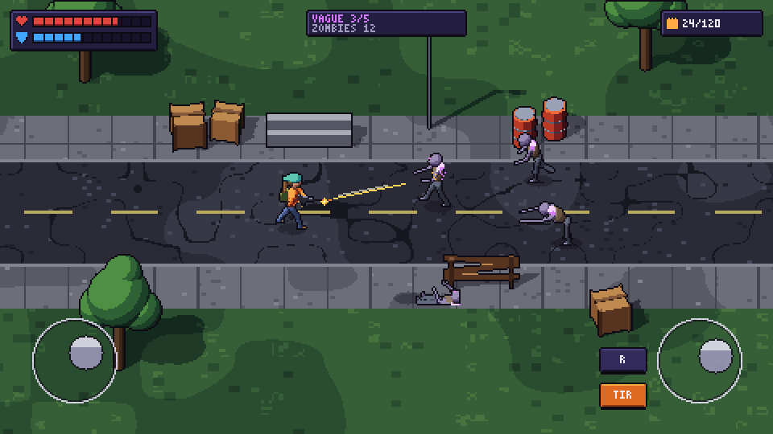

| Marche 8 directions | Actions du survivant | Rôdeur |
|---|---|---|
| 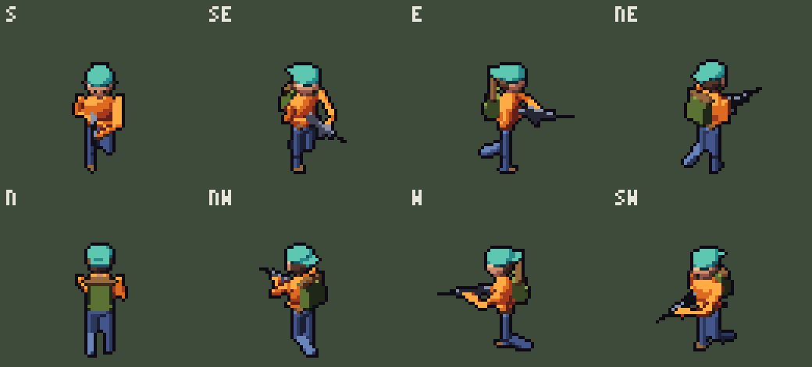 | 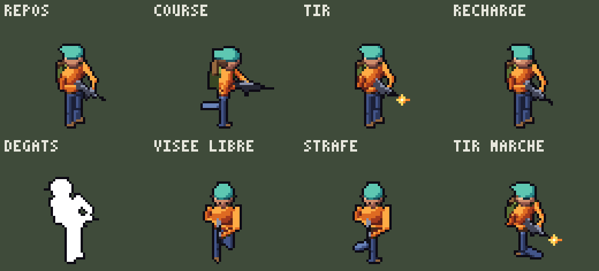 | 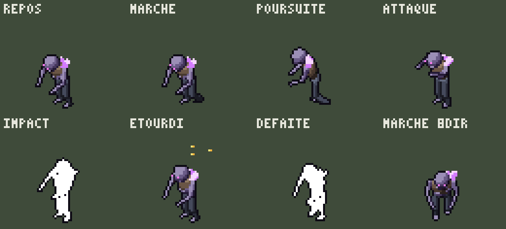 |

[Planche de sprites A](proposition-A/planche-sprites-x3.png)

## Proposition B — « Isométrique 2:1 »
Iso classique (losanges 2:1), personnage d'environ **40 px**, **contour sélectif** (coloré), palette **Cendres** (désaturée, Rôdeurs verts), résolution interne **480×270**.

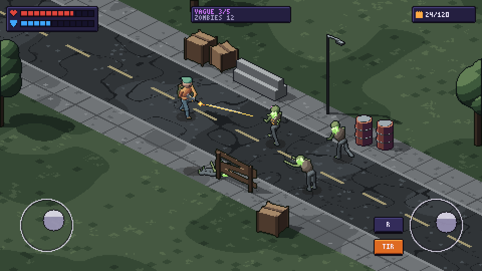

| Marche 8 directions | Actions du survivant | Rôdeur |
|---|---|---|
| 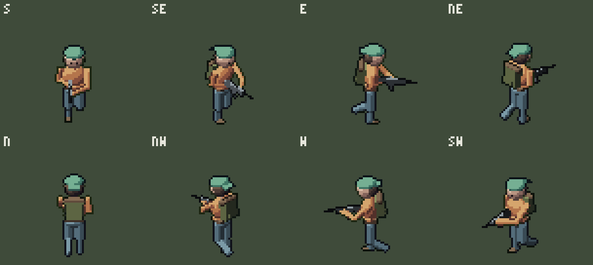 | 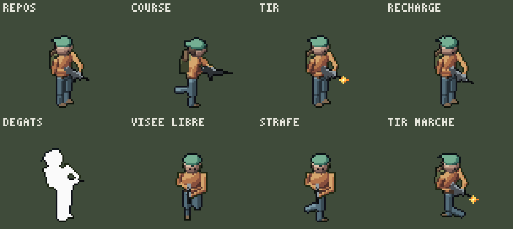 | 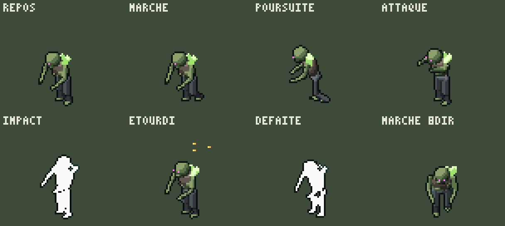 |

[Planche de sprites B](proposition-B/planche-sprites-x3.png)

## Proposition C — « 3/4 détaillé »
Vue de 3/4, personnage d'environ **56 px**, **contour sélectif**, palette **Tempête**, résolution interne **640×360** (caméra plus proche).

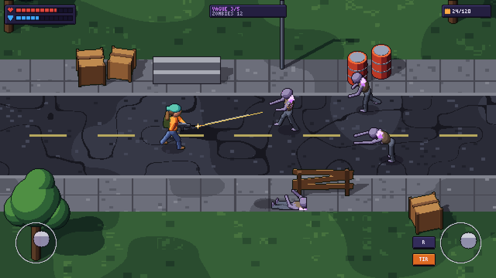

| Marche 8 directions | Actions du survivant | Rôdeur |
|---|---|---|
| 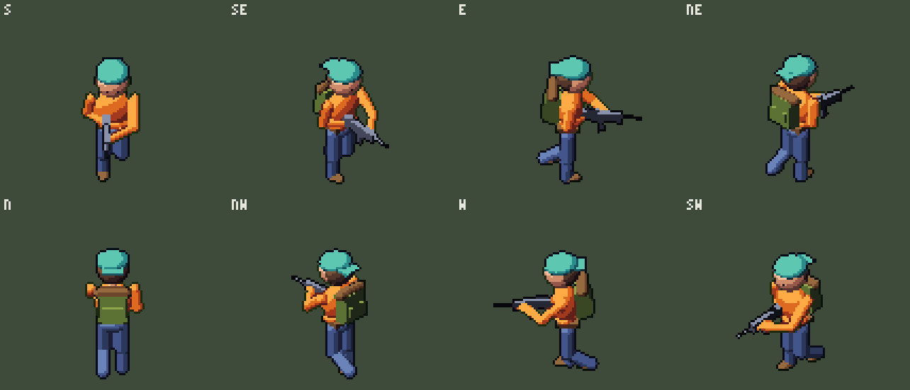 | 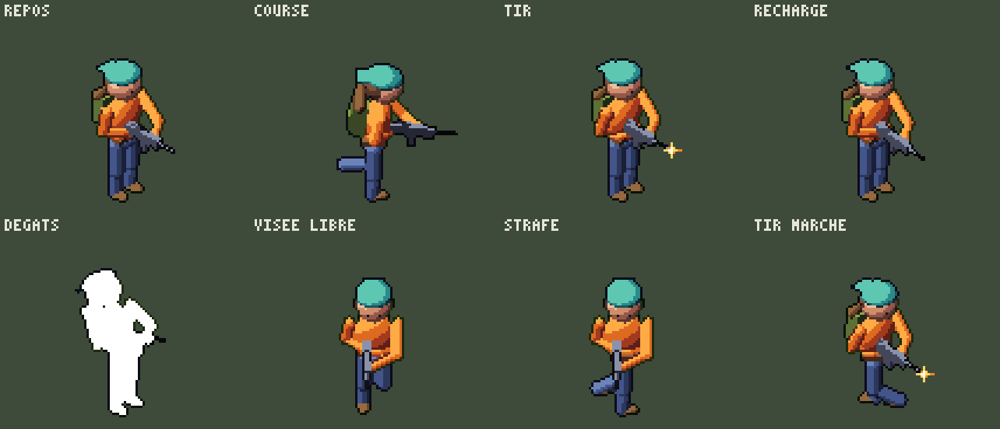 | 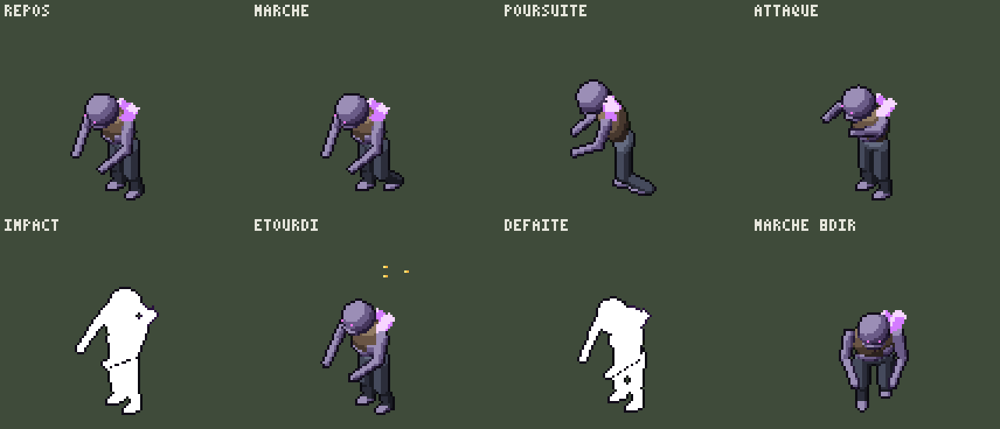 |

[Planche de sprites C](proposition-C/planche-sprites-x3.png)

## Interface, palettes, méthodes

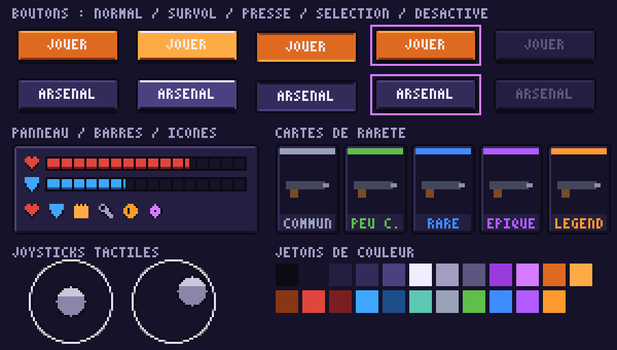

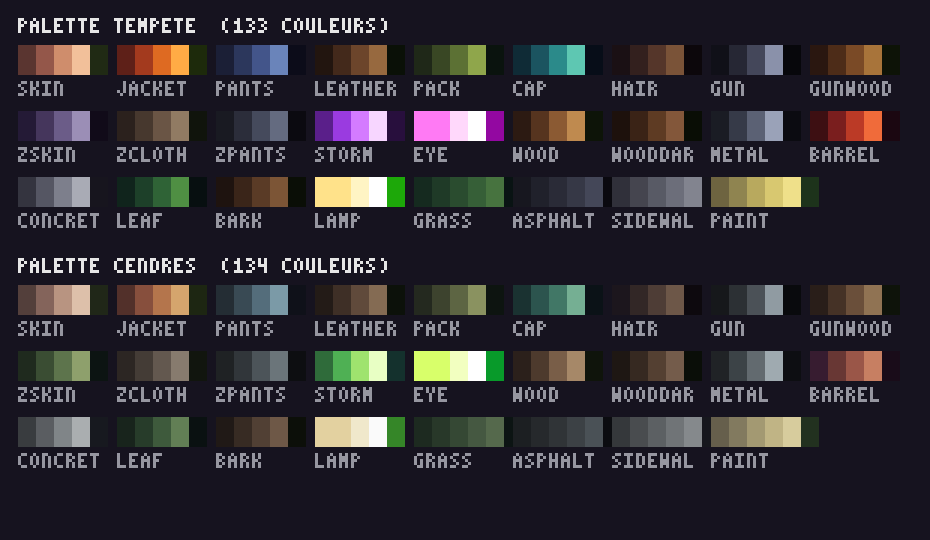

**Test des méthodes de production** (survivant, proposition A) : rendu brut → contours et nettoyage automatiques → retouche manuelle pixel par pixel.

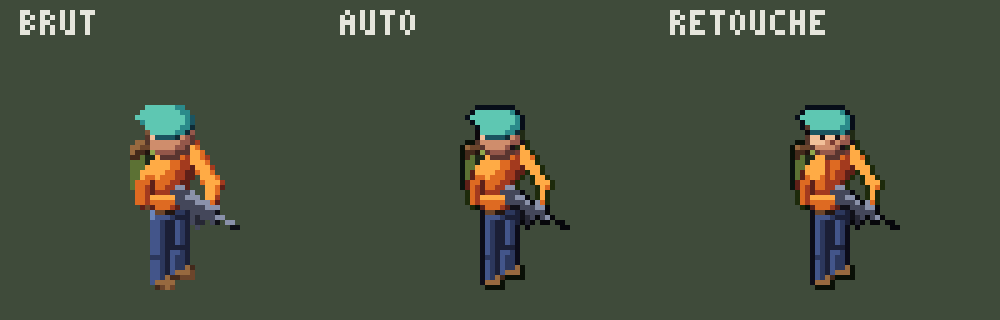
